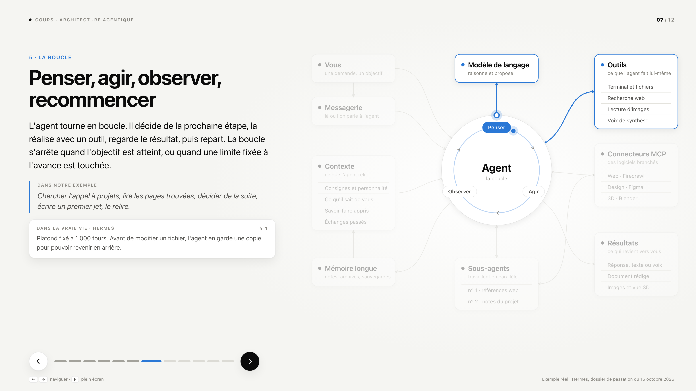

# Comment travaille un agent IA

Présentation pas à pas, en 12 slides (environ 15 minutes), pour expliquer à des débutants le fonctionnement d'une architecture agentique. Un seul exemple traverse le cours : un mémo vocal qui demande une note d'intention et une vue 3D pour un appel à projets. Des encadrés « Dans la vraie vie · Hermes » montrent que chaque brique existe vraiment.

**Voir la présentation : https://guillaumehelleu.com/comment-travaille-un-agent/**

## Présenter

- → ou Espace : slide suivante · ← : précédente · F : plein écran.
- Un clic sur le schéma passe aussi à la slide suivante.
- `#7` à la fin de l'adresse ouvre directement la slide 7.
- Hors connexion : télécharger `comment-travaille-un-agent.html` (tout en un seul fichier) et l'ouvrir par double-clic.

## Déroulé

1. Introduction · 2. Un agent poursuit un objectif · 3. La demande · 4. Un agent est un assemblage · 5. Le contexte · 6. Le modèle · 7. La boucle · 8. Les outils · 9. Les connecteurs MCP · 10. Déléguer · 11. Livrer et garder une trace · 12. Les limites

## Modifier

Les textes et le schéma sont dans `contenu.js`. Les couleurs et les tailles sont dans `styles.css`. Aucune bibliothèque, aucune dépendance.

## Sources

Le schéma décrit une architecture agentique standard. Les chiffres des encadrés Hermes viennent du dossier de passation du 15 octobre 2026 (section indiquée dans chaque encadré).
